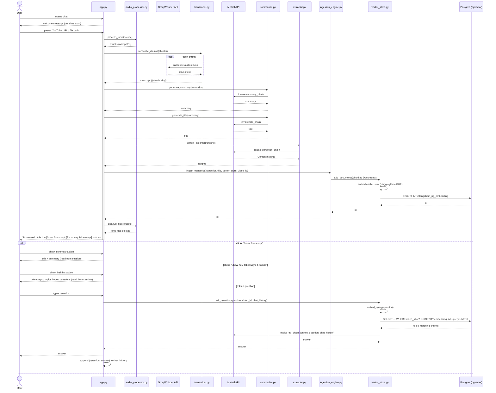

# VidAI

Turn a video (YouTube link or local audio/video file) into a searchable, chatty summary.

## What it does, in simple terms

1. **Take a video** — paste a YouTube URL or a local audio file path into the chat.
2. **Download & chunk the audio** — the video's audio is pulled down, converted to a clean format, and cut into smaller pieces (so it fits the transcription service's limits).
3. **Transcribe** — each audio chunk is sent to Groq's Whisper model and turned into text, then stitched back into one full transcript.
4. **Summarize** — the full transcript is sent to an LLM (Mistral) to generate a short title and a bullet-point summary.
5. **Extract insights** — a second pass over the transcript pulls out key takeaways, topics covered, and open questions.
6. **Store for Q&A** — the transcript is split into small text chunks and saved into a Postgres (pgvector) database, tagged to that specific video.
7. **Chat about it** — ask questions in the same chat; your question is matched against the stored chunks for *that video only*, and the LLM answers using just that context.

## Full application flow



## Running it

```powershell
chainlit run app.py -w
```

Opens a chat UI at `http://localhost:8000`. Paste a YouTube URL or local file path to process a video, then ask questions about it.

## Requirements

- Python deps: `pip install -r requirements.txt`
- A running Postgres instance with the `pgvector` extension (see `docker run ... pgvector/pgvector:pg16`)
- A `.env` file with `MISTRAL_API_KEY`, `GROQ_API_KEY`, and `PGVECTOR_URL` (your Postgres connection string)

## Project layout

- `app.py` — the Chainlit chat UI and orchestration
- `utils/audio_processor.py` — download, convert, and chunk audio
- `core/transcriber.py` — audio chunks → text (Groq Whisper)
- `core/summarise.py` — transcript → title + summary (Mistral)
- `core/extractor.py` — transcript → key takeaways / topics / open questions (Mistral)
- `core/ingestion_engine.py` — transcript → chunks stored in pgvector
- `core/vector_store.py` — retrieval + question answering (RAG) over stored chunks
- `core/llm.py` — shared Mistral client setup
